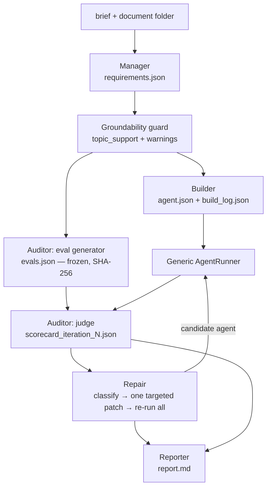

# ForgeAI — an agent factory that builds, audits and repairs document-grounded agents

**Live results viewer:** https://tanmayk03-forgeai-streamlit-app-7k64by.streamlit.app/ (read-only view of the committed runs; agents are built locally, see [Quick start](#1-quick-start))

ForgeAI takes a **one-paragraph brief** and a **folder of documents** (PDF, Markdown, text, CSV) and,
unattended, produces a working question-answering agent together with **evidence of how good it is**:
a structured requirements specification, a groundability analysis, a declarative agent definition,
a self-generated and frozen evaluation set, per-iteration scorecards, a failure taxonomy, a log of
targeted repairs, and an honest final report.

Everything runs **locally on a CPU laptop** (8 GB RAM, no GPU) with a single small model,
**Qwen 2.5 1.5B via Ollama**. There are no paid APIs and no agent frameworks — the orchestration,
retrieval, evaluation and repair logic are plain, tested Python.

> Design principle: **the pipeline distrusts its own model.** Wherever a 1.5B model's judgement would
> be unreliable, the decision is made by deterministic code, and every model output that matters is
> verified in code before it is used.

---

## Contents

1. [Quick start](#1-quick-start) (and the [results viewer](#results-viewer-deployed))
2. [Architecture](#2-architecture)
3. [The roles in detail](#3-the-roles-in-detail)
4. [The agent runtime](#4-the-agent-runtime)
5. [Evaluation methodology](#5-evaluation-methodology)
6. [Repair methodology](#6-repair-methodology)
7. [Artifacts of a run](#7-artifacts-of-a-run)
8. [Demo results](#8-demo-results)
9. [Design decisions and the evidence behind them](#9-design-decisions-and-the-evidence-behind-them)
10. [Known limitations](#10-known-limitations)
11. [Configuration](#11-configuration)
12. [Project layout and tests](#12-project-layout-and-tests)
13. [Mapping to the assignment requirements](#13-mapping-to-the-assignment-requirements)

---

## 1. Quick start

**Requirements:** Python 3.11+, [Ollama](https://ollama.com), ~2 GB disk for the model.

```powershell
# Windows PowerShell, from the project root
python -m venv .venv
.venv\Scripts\activate
python -m pip install -r requirements.txt
ollama pull qwen2.5:1.5b

python -m scripts.check_connection          # Ollama reachable, model present, test prompt
python -m unittest discover -s tests -t .   # 169 offline tests (fake models, no Ollama needed)
```

**Run the whole factory** (unattended):

```powershell
python -m scripts.forge --brief data\briefs\demo1_hr.txt --docs data\demo1_hr --run demo1_hr --auto
```

`--brief` accepts the text itself or a path to a `.txt` file. Without `--auto`, the Manager asks the
five interview questions interactively. `--iterations 1` limits repair to one round (shorter live runs).

**Use the agent it built:**

```powershell
python -m scripts.chat --agent runs\demo1_hr\agent_final.json --trace
```

**Run stages individually** (each reads and writes `runs/<run>/`):

| Stage | Command |
|---|---|
| Requirements (Manager) | `python -m scripts.intake --brief ... --docs ... --run R [--auto]` |
| Groundability guard | `python -m scripts.guard --run R` |
| Agent generation (Builder) | `python -m scripts.build --run R` |
| Eval generation (Auditor) | `python -m scripts.make_evals --run R` |
| Judge | `python -m scripts.run_evals --run R [--agent path] [--label L]` |
| Repair | `python -m scripts.repair --run R [--iterations N]` |
| Report | `python -m scripts.report --run R` |
| Compare two scorecards | `python -m scripts.compare_scorecards A.json B.json` |

---

## 2. Architecture

ForgeAI is a **fixed, file-based pipeline of roles**. Roles do not talk to each other directly; each
reads the artifacts it is allowed to see and writes new ones. This makes every hand-off inspectable,
every run reproducible, and the information boundaries between roles enforceable in code.



### Information boundaries (independence)

| Artifact | Manager | Guard | Builder | Eval generator | Judge | Repair |
|---|---|---|---|---|---|---|
| brief + documents | ✅ | ✅ | ✅ | ✅ | — | — |
| `requirements.json` | writes | updates | reads | reads | — | — |
| `agent.json` | — | — | writes | **never** | via runner only | patches |
| `evals.json` | — | — | **never** | writes (frozen) | reads | reads results |

* The **eval generator never reads the agent definition** and chunks the documents with its own
  default settings. Expected sources are therefore recorded as **document names**, not chunk IDs
  (chunk IDs differ between the agent's and the Auditor's chunking).
* The **judge treats the agent as a black box**: it calls the same `AgentRunner.ask()` that the chat
  CLI uses, so what is tested is exactly what a user talks to.
* The eval set is **frozen with a SHA-256 hash** of its cases; the judge refuses to score a set whose
  hash no longer matches.
* The shared contract between Builder and Auditor is `requirements.json`. Its errors are shared by
  both (see [limitations](#10-known-limitations)); the guard and the out-of-scope test cases built from
  the refuse list mitigate this.

### Determinism

All model calls use `temperature = 0` and a fixed `seed`, and every random choice in code uses
`random.Random(config.SEED)`. Two runs on the same inputs therefore give the same eval set (verified
in tests by comparing SHA-256 hashes) and, as far as Ollama is deterministic, the same answers —
so a score change between repair iterations is attributable to the change, not to sampling noise.

---

## 3. The roles in detail

### 3.1 Manager — `forgeai/roles/manager.py`

Turns the brief into a structured specification: purpose, scope, audience, tone, **must-answer** and
**must-refuse** topics, plus a document inventory.

1. **Inventory (code):** loads every file, records pages/words, a preview and frequency keywords.
2. **Draft (one LLM call):** the model drafts the requirement fields as JSON constrained by a JSON
   schema (`prompts/manager_draft.txt`).
3. **Interview:** a **fixed five-question design interview** (audience, tone, must-answer, must-refuse,
   scope). The model's draft supplies each question's default. Answers overwrite the field **in code**;
   an empty answer or `--auto` keeps the default and records it as `"assumed"`.
4. **Clean-up (code):** de-duplicates topics, converts column-style names (`lead_time_days` →
   `lead time days`), caps list sizes, resolves topics listed as both answer and refuse (refuse wins),
   and logs every fix in `notes`.

### 3.2 Groundability guard — `forgeai/roles/guard.py`

Answers *"can these documents actually support what the brief asks for?"* **before** an agent is built.
For each must-answer topic:

| Evidence | Decision | Model call? |
|---|---|---|
| none of the topic's key words appear in any document | **unsupported** | no |
| all key words in one passage, or ≥ 50 % of them in one CSV | **supported** | no |
| in between | model reads the best passages and must **quote** a sentence; code verifies ≥ 80 % of the quote's words occur in the passages. Unverifiable quote ⇒ **unsupported** (fail closed) | yes |

It also emits warnings (information only): refuse topics that occur in the documents (risk of wrong
refusals) and **distinctive** document keywords — ranked by `count × idf` — that no must-answer topic
covers. Unsupported topics become **refusal topics** in the Builder.

### 3.3 Builder — `forgeai/roles/builder.py`

Produces a **declarative** `agent.json` (validated by a Pydantic schema with `extra="forbid"`).

* **Tool selection is rule-based**, each decision logged with a reason in `build_log.json`:
  * `csv_lookup` only if the folder contains a CSV whose vocabulary overlaps the requirements;
  * `calculator`, `weather_api`, `current_date` only if the requirements contain trigger words
    (e.g. *total, cost, discount* / *weather, forecast* / *today, deadline*).
* **Scope** = topics the guard marked supported; **refusal topics** = must-refuse ∪ unsupported.
* **Retrieval** parameters are sized from document statistics and constrained so that
  `top_k × chunk_size × 1.3 ≤ 60 %` of the context window.
* **Output contract:** citations required, unsupported numbers blocked, answer length from tone.
* **The model writes only the persona** (2–4 sentences). Code checks length and rejects text that
  weakens grounding ("use general knowledge", "guess", …), falling back to a template. The grounding
  and refusal rules themselves are **not** model-written: they live in `prompts/runner_system.txt`.

### 3.4 Auditor, part 1 — eval generator — `forgeai/roles/eval_generator.py`

Generates the test set from the documents and requirements only.

| Case type | Generation | Validation in code |
|---|---|---|
| `answerable` | model writes questions + key facts from one passage | every key fact must occur in the passage (normalised, whole-word); question must not contain its own answer; Jaccard < 0.75 to all kept questions |
| CSV rows | built by code from sampled rows (only if the CSV relates to the brief) | — |
| `multi_doc` | code joins two accepted questions from **different documents**; answer must contain both facts and cite both documents | — |
| `ambiguous` | model rewrites accepted questions informally | rewrite must differ (Jaccard < 0.8) and not leak the answer |
| `out_of_scope` | model writes refuse-topic and unrelated questions; guard-unsupported topics are built by code | "unrelated" questions are rejected if > 34 % of their words occur in the documents |

Key facts are **strengthened in code**: a bare number takes its unit from the passage (`24` →
`24 working days`), and an over-long fact is cut to its number phrase. Rejected cases are saved with
reasons; fewer than 20 valid cases is **reported, never padded**. The generation prompts are committed
in `prompts/auditor_*.txt`.

### 3.5 Auditor, part 2 — judge — `forgeai/roles/judge.py`

See [§5](#5-evaluation-methodology).

### 3.6 Repair — `forgeai/roles/repair.py`

See [§6](#6-repair-methodology).

### 3.7 Reporter — `forgeai/roles/reporter.py`

Writes `report.md` **from the artifacts only, with no model**, so it cannot overstate results: final
and baseline scores, requirements, groundability table, tool decisions, eval-set composition and hash,
a scorecard per repair iteration (change, fixed, broken, kept/rolled back), every still-failing case
with its category and evidence, and a fixed list of known limitations.

---

## 4. The agent runtime

`forgeai/runtime/runner.py` — **one generic `AgentRunner`** executes any valid `agent.json`.
`ask(question)` runs five stages and always returns an `AgentResponse`
(`answer`, `sources`, `refused`, `refusal_reason`, and a full `trace`):

1. **Retrieve.** BM25 (Okapi) over the agent's chunks, with the agent's own chunk size, overlap and
   `top_k`. Tokenisation lowercases, joins digit groups (`6,000` → `6000`), removes stopwords and
   plural endings (`policies` → `policy`). IDF uses the Lucene formula
   `log(1 + (N − n + 0.5)/(n + 0.5))`, which — unlike `rank_bm25`'s default — is never negative, so
   single-document corpora still retrieve.
2. **Evidence gate (code).** No chunk with a positive score, or *query coverage* (share of the
   question's key terms present in the retrieved chunks) below `min_query_coverage` ⇒ refuse
   **without calling the model**. A BM25 hit is not treated as evidence on its own. Skipped for agents
   with tools, since a tool may supply the evidence.
3. **Tools.** `csv_lookup` and `current_date` are run automatically by the runner; `calculator` and
   `weather_api` are chosen in a short planning call whose JSON schema restricts the answer to an
   **enum of allowed tool names or `"none"`** — and only when the question hints at a calculation or
   weather. Tool results become numbered, citable sources. The model may still request a tool while
   answering (max 2 calls, duplicates not re-run, one last-chance answer at the limit).
4. **Generate.** The model receives numbered sources `[1] … [n]` and must return JSON matching a
   schema (`answer`, `sources`, `refused`, `refusal_reason`, `tool_name`, `tool_input`), enforced by
   Ollama's structured-output `format`. Output is parsed defensively (code fences, stray text, missing
   fields) with one retry.
5. **Verify (code, fail-closed).** An answer citing no valid source ⇒ refusal. Any number in the
   answer not present in the cited sources (or a tool result) ⇒ refusal
   (`block_unsupported_numbers`). The model's overridden answer is kept in the trace for auditing.

Ollama failures (not running, model missing, timeout) are **raised, never converted into refusals** —
an outage must not be scored as a correct refusal.

**Tools** (`forgeai/tools/`): `csv_lookup` (token-overlap row search, returns file and row number),
`calculator` (AST-walking evaluator — only numeric literals and `+ − × ÷ // % **` with an exponent
cap; never `eval()`), `weather_api` (open-meteo geocoding + forecast, no key), `current_date`.
`run_tool()` never raises; failures become `ok=False` results.

---

## 5. Evaluation methodology

Each frozen case is run through the runner and scored **code-first**:

* **Should answer** → pass iff *not refused* ∧ *every key fact present* ∧ *grounded*.
  * Fact matching: (1) exact normalised phrase; (2) fuzzy — ≥ 80 % of the fact's words present and
    **every number exact**; (3) *context* — words of the fact that the question already contains need
    not be repeated ("What is the discount rate?" → "3 percent" states "3 percent discount"), the
    remaining words and every number must be present; (4) only then an LLM check.
  * Grounded: cited documents intersect the expected documents (multi-document cases: **all**
    expected documents must be cited). `tool:csv_lookup` sources map to the CSV files.
* **Should refuse** → pass iff refused.
* Runner errors are recorded as `error` and excluded from the pass rate.

### LLM-as-a-judge and its bias defences

The LLM is consulted only for facts code could not find, one fact at a time, with a yes/no question
(`prompts/judge_fact.txt`).

| Known bias | Defence |
|---|---|
| **Position bias** | never compares two answers; pointwise only |
| **Verbosity bias** | never asked about quality or length; one binary fact per call |
| **Self-preference** (same model family) | code decides most facts; an LLM "yes" counts only with a **quote that code verifies inside the answer** and that contains the fact's numbers |

### Auditing the judge itself

* **Quote verification works — and was too strict.** In the saved demo answers the LLM judge said
  "yes" seven times where code then rejected its quote. Three were genuinely wrong answers (e.g. INR
  6,000 given for a USD 180 limit): the defence caught them. Four were correct short answers whose
  missing words were already in the question ("3 percent" for "the discount rate"). The *context*
  rule fixes those four and still fails the three wrong ones (tests use these exact cases).
* `scripts/rejudge.py` re-scores **saved answers** with the current judge — no agent, no model, instant —
  so a judge change can be shown on identical answers (demo2 baseline 42 % → 54 %, rehearsal baseline
  64 % → 68 %, demo1 unchanged).
* `scripts/label_judge.py` measures **judge–human agreement**: a person labels a sample of saved
  answers (all judge failures first), and the tool reports agreement plus every case where the judge
  was too lenient or too strict. The result is shown in the report and the viewer.

In the demos the judge needed **3 LLM calls for 22 cases** (demo1) and **8 for 25** (demo2); everything else was decided by code.

---

## 6. Repair methodology

Repair is **code-only**. A 1.5B model diagnosing its own failures is not reliable, and model-written
fixes tend to become full rewrites or to paste test text into the prompt.

### Failure taxonomy (deterministic, from the judge's evidence)

| Observation | Category (subtype) |
|---|---|
| refused by the evidence gate although the expected document was retrieved | **wrong refusal** (gate) |
| refused and the expected document was not retrieved | **retrieval miss** |
| model refused although the expected document was retrieved | **wrong refusal** (model) |
| blocked by a citation/number check, model's own answer contained the facts | **prompt defect** (citation) |
| blocked by a check, model's own answer lacked the facts | **hallucination** |
| answered, expected document not retrieved | **retrieval miss** |
| answered, facts missing (multi-document case) | **prompt defect** (multi_part) |
| answered, facts missing | **prompt defect** (incomplete) |
| answered with the facts but citing the wrong documents | **prompt defect** (citation) |
| answered a question that should be refused | **prompt defect** (refusal rule) |

### Repair loop

1. Pick the largest (category, subtype) group whose fix is still untried.
2. Apply **one** patch from a fixed library — `top_k + 1`, smaller chunks, lower
   `min_query_coverage`, or **one appended instruction sentence** for that subtype. Never a
   regeneration; never text taken from the eval set.
3. Re-run **all** evals (fixes can break passing cases).
4. **Keep the patch only if strictly more cases pass**; otherwise roll back (logged as
   "score dropped" or "no gain"). A rolled-back change is never retried.
5. At most three iterations. The best agent is saved as `agent_final.json`.

Every iteration is logged in `repair_log.json`: category, subtype, targeted cases, the changed field
with old and new value, score before and after, fixed and broken case IDs, and the decision.

---

## 7. Artifacts of a run

`runs/<run>/` contains everything needed to audit the run:

| File | Content |
|---|---|
| `requirements.json` | spec, clarifications (requester / assumed), document inventory, `topic_support`, guard warnings |
| `groundability.json` | guard verdicts with method, coverage, evidence and quotes |
| `agent.json`, `build_log.json` | built agent and the reason for every decision |
| `evals.json`, `evals_rejected.json` | frozen eval set (with SHA-256) and rejected candidates with reasons |
| `scorecard_iteration_N.json` | per-case results: answer, sources, cited/retrieved documents, fact checks, runner decision |
| `agent_iteration_N.json`, `agent_final.json` | candidate agents and the kept best |
| `repair_log.json` | the repair decisions described above |
| `report.md`, `timings.json` | final report and seconds per stage |
| `*_log.json` | every model prompt and raw reply, per role |

---

## 8. Demo results

Two deliberately different demos, run unattended with `--auto` on a CPU laptop. The documents are
synthetic (fictional company); the synthesis prompts are in [`data/SYNTHESIS.md`](data/SYNTHESIS.md).

| | demo1_hr | demo2_spares |
|---|---|---|
| Documents | 2 policy PDFs + code of conduct (Markdown) | 25-row parts CSV + 2 supplier terms + procurement rules |
| Guard | 6 topics supported, **"company pension scheme" unsupported** (no document covers it) → became a refusal topic | 6/6 supported, all decided by code in 0 s (CSV-backed topics checked against the catalogue) |
| Tools attached | none (correct: text-only Q&A) | `csv_lookup`, `calculator` (no weather / date tool) |
| Eval set | 22 cases (12 answerable, 3 multi-doc, 3 ambiguous, 4 out-of-scope), 11 rejected | 24 cases (13 answerable, 3 multi-doc, 2 ambiguous, 6 out-of-scope), 12 rejected |
| Baseline | 18/22 (82 %) | 10/24 (42 %) |
| Repair | 3 instruction patches, each "no gain" → all rolled back | 3 instruction patches: two fixed one case but broke another (net 0), one lowered the score → all rolled back |
| **Final** | **18/22 (82 %)** | **10/24 (42 %)** |
| Total time | ≈ 20 min | ≈ 38 min |

**Scores are only comparable on the same eval set.** An earlier demo2 run (before plural handling)
scored 15/25 on a *different* generated eval set. A small input change (here, tokenisation) changes the
Manager's draft, hence the requirements, hence the generated questions — so run-to-run scores measure
different exams. The like-for-like check is to re-run the **same frozen evals** with the same agent:
doing that before and after plural handling gave an identical 15/25 with no case going from pass to
fail (`scripts/compare_scorecards.py`). The committed run is the one produced by the final code.

**Why demo2 is lower:** the remaining failures are dominated by the model confusing the two supplier
documents (citing Oceanparts for a Marisupply fact), dropping units or conditions from figures,
citing a document instead of the CSV row for catalogue questions, and answering only one half of
combined questions. These are capability limits of a 1.5B model; the code
checks prevent them from being reported as successes.

---

### Results viewer (deployed)

`streamlit_app.py` is a **read-only web viewer** of the committed runs: requirements and interview,
groundability verdicts, tool decisions, the agent definition, the frozen eval set and rejected
candidates, per-case results for every iteration, the repair log and the report. It reads the JSON
artifacts only — no model, no Ollama — so it runs on free hosting (Streamlit Community Cloud).
Building new agents needs the local model and runs on the laptop (`scripts/forge.py`).

```powershell
python -m pip install streamlit
streamlit run streamlit_app.py
```

## 9. Design decisions and the evidence behind them

| Decision | Why — what was observed |
|---|---|
| Fixed five-question interview instead of model-generated questions | Asked to write clarifying questions, the model wrote **end-user questions** ("Can I carry over unused leave?") and answered them itself. |
| Block answers with unsupported numbers | The model invented **"8 weeks" of maternity leave** while citing a real chunk; only the number check caught it. |
| Runner runs CSV/date tools itself; enum-constrained tool planner | The model **never called a tool on its own** ("What is the unit price…?" was refused or answered with an invented "120"). After the change, both parts questions were answered correctly (145.00 and 580). |
| Multi-document cases built by code | Model-written "multi-document" questions asked one thing while their answer keys contained an unrelated fact from the other document — guaranteed false failures. |
| Key facts strengthened and verified in code | The model produced bare numbers (`"5"`) and whole sentences as "key facts". |
| Code-first judge with verified quotes | Keeps self-preference and verbosity out of the score; most cases need no LLM call. |
| Code-only repair with a fixed patch library | Prevents overfitting by copying test text and full regenerations; makes every change explainable. The demos show instruction patches rarely help a 1.5B model — a finding the logs prove. |
| Keep a patch only on strict improvement | A "no gain" patch only lengthens the prompt; in one run it would otherwise have been kept. |
| Lucene IDF, plural handling | `rank_bm25`'s IDF gave negative scores for one-document folders; exact matching marked "identify suppliers" unsupported because the documents say "supplier". |
| No agent framework, no vector DB | Every step stays visible, testable and explainable on modest hardware. |

---

## 10. Known limitations

* **One small model.** Qwen 2.5 1.5B writes the persona and draft requirements, generates questions
  and judges unclear facts. Code checks limit its influence but cannot remove it; answer quality is the
  main ceiling (supplier confusion, missing units, partial answers).
* **Shared specification.** Builder and Auditor both rely on `requirements.json`; a mistaken
  requirement can be built and tested consistently. Out-of-scope cases from the refuse list and the
  guard's warnings mitigate, but do not eliminate, this.
* **Lexical matching.** Retrieval, the evidence gate and the guard are keyword based. Plural
  handling helps, but synonyms ("time off" vs "leave") are not matched.
* **Lenient CSV rule in the guard.** A topic counts as supported when ≥ 50 % of its key words appear in
  a CSV, so a two-word topic can pass on one word (e.g. a hypothetical "supplier bankruptcy").
* **Refuse topics that overlap the documents** (e.g. "Medical" vs a sick-leave certificate question)
  create genuine policy conflicts; the guard warns, but the outcome depends on the model.
* **Multi-document cases** test answers that span two documents, not reasoning across them.
* **Paraphrased facts** (e.g. spelled-out numbers) can be scored as missing.
* **Optimistic final score.** Repair tunes on the same eval set it reports; there is no held-out split.
* **Run-to-run variance of the eval set.** Each run generates its own questions, so scores of two
  runs are not directly comparable; compare changes on the same frozen set.
* **Runtime.** 20–60 minutes per full run on CPU; `--iterations 1` shortens live runs.

---

## 11. Configuration

All settings live in `forgeai/config.py` and can be overridden with environment variables
(PowerShell: `$env:FORGEAI_MODEL = "qwen2.5:3b"`).

| Variable | Default | Meaning |
|---|---|---|
| `FORGEAI_OLLAMA_URL` | `http://localhost:11434` | Ollama server |
| `FORGEAI_MODEL` | `qwen2.5:1.5b` | model for every role |
| `FORGEAI_TEMPERATURE` / `FORGEAI_SEED` | `0.0` / `42` | determinism |
| `FORGEAI_NUM_CTX` | `4096` | context window (set explicitly: Ollama truncates silently) |
| `FORGEAI_MAX_TOKENS` | `512` | maximum reply length |
| `FORGEAI_KEEP_ALIVE` | `30m` | keep the model loaded between calls |
| `FORGEAI_TIMEOUT` | `180` | seconds per model call |
| `FORGEAI_OUTPUT_RETRIES` | `1` | retries for unusable JSON |
| `FORGEAI_MAX_TOOL_CALLS` | `2` | model-requested tool calls per question |
| `FORGEAI_CHUNK_SIZE` / `FORGEAI_CHUNK_OVERLAP` / `FORGEAI_TOP_K` | `300` / `50` / `3` | retrieval defaults |

---

## 12. Project layout and tests

```
forgeai/
  config.py            settings
  llm_client.py        the only code that talks to Ollama (errors, JSON-schema output, keep_alive)
  llm_json.py          schema-validated JSON calls with retry, used by the roles
  retrieval/           loader (PDF/text/CSV), chunker, BM25 index + tokenizer
  runtime/             agent schema, runner, prompt builder, output parser, evidence checks
  tools/               registry + csv_lookup, calculator, weather_api, current_date
  roles/               manager, guard, builder, eval_generator, judge, repair, reporter
prompts/               every prompt template (committed, as required)
scripts/               command-line entry points (forge, chat, and one per stage)
tests/                 169 unittest tests; fake models make them run offline in < 1 s
data/                  sample_docs, demo1_hr, demo2_spares, briefs/, SYNTHESIS.md
runs/                  committed demo artifacts
```

Tests cover every module, including adversarial cases: invented answer keys, leaky questions,
malformed and empty model output, tampered eval sets, Ollama outages, disallowed tools,
calculator code-injection attempts, one-document corpora, and the repair loop's keep/rollback rules.

```powershell
python -m unittest discover -s tests -t . -v
```

---

## 13. Mapping to the assignment requirements

| # | Requirement | Implementation |
|---|---|---|
| 1 | Intake interviewer (≤ 5 questions) → structured requirements | `roles/manager.py`, `scripts/intake.py`, `--auto` |
| 2 | Groundability guard | `roles/guard.py` |
| 3 | Agent generator: prompt, chunking/retrieval, only needed tools, output contract | `roles/builder.py`, `runtime/agent_schema.py` |
| 4 | ≥ 20 generated evals (answerable, out-of-scope, edge cases), committed prompts | `roles/eval_generator.py`, `prompts/auditor_*.txt` |
| 5 | Judge with bias defences / deterministic checks | `roles/judge.py` |
| 6 | Failure classification (4 categories), targeted fixes, ≤ 3 iterations, full logs | `roles/repair.py`, `repair_log.json` |
| 7 | Honest reporting | `roles/reporter.py`, `report.md` |
| 8 | Generic runnable chat runner | `runtime/runner.py`, `scripts/chat.py` |
| 9 | Two full demonstrations with all artifacts | `runs/demo1_hr`, `runs/demo2_spares` |
| — | Tool registry (CSV, calculator, keyless HTTP API, date) | `forgeai/tools/` |
